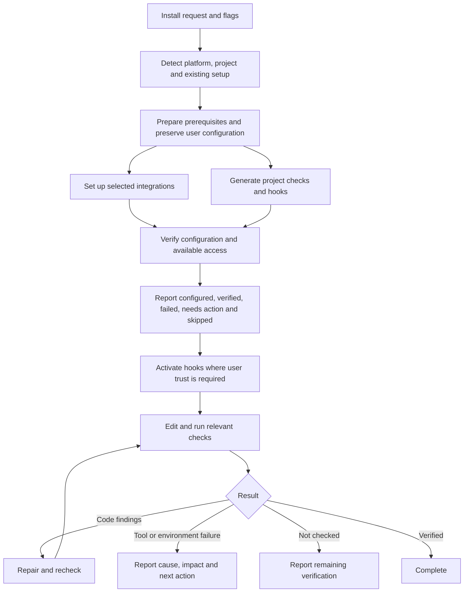
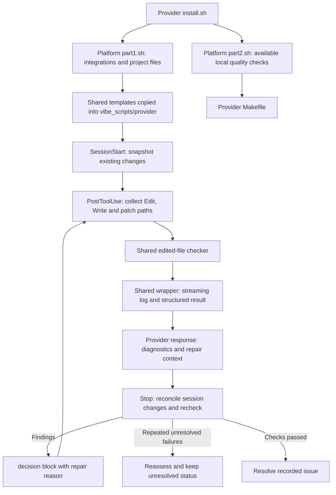

# Installation, checks, and repair

This document separates the intended workflow, source implementation, generated
project files, and activation in an agent session. An installed file or
registered
MCP server does not prove that a hook is trusted or a remote request works.

## Intended workflow

Routine `lint-ai` checks current-session changes without formatting.
Use `./vibe_scripts/codex/agent-verify.sh lint PATH ...` for explicit files,
`edited PATH ...` to format and check them, and `lint --all` for full-project
lint. Substitute `claude` for the Claude helper. `verify-ai` runs broader
verification without formatting; Fallow analysis is on demand.

Lint and formatting stay within supported, existing selected files. Deleted files,
metadata, media and unsupported formats are skipped; configuration changes do not
expand file targets. Missing required tools and actual lint/format failures block.
Tests, builds and type checks remain separate workflows. At Stop, changed UI
markup or styles require a scoped design review; logic-only edits do not.
Automatic hooks emit only `PASS` on success and nothing when no files apply.
Failures have concise diagnostics and an evidence path. Unchanged blocked Stops
reuse the existing result without rerunning tools or creating duplicate logs.
Explicit checks always run and invalidate older automatic failure results.
Complete evidence stays on disk.
TOML configuration inspection requires Python 3.11 or newer; other checks remain
available on older supported Python runtimes.

From the VibeHelper source checkout, refresh only quality assets in an existing
installation with `python3 templates/vibe_scripts/managed-install.py quality-refresh --provider codex --root /absolute/project`.
Add `--dry-run` to preview. Modified files are preserved. A reviewed previous
source directory can establish exact runtime or generated-hook provenance when
a receipt is stale; a separately reviewed Makefile hash permits only the scoped
target migration. Neither option authorizes unrelated installer work or autofix.

## Source paths and generated execution

The earlier source could skip part 2 after an integration failure, activate a
globally available Semgrep, miss patch paths, and suppress repair continuation
at
Codex Stop. Shared templates also had weaker diagnostics than generated Codex
scripts. These are regression cases, not supported operating modes.

## Evidence by step

| Step | Verification |
| --- | --- |
| Unified install flags | Platform matrix |
| Integration setup | Access failure fixtures |
| Managed refresh | Package-call recording |
| Legacy migration | Migration fixtures |
| Hook generation | Asset and isolation tests |
| Session start | Session state fixtures |
| Post-edit check | Payload and PHP fixtures |
| Final check | Repair-loop fixtures |
| Cleanup | Ownership fixtures |

### Unified install flags

Trigger: invoke either provider's `install.sh` with a repository and flags.

Dependencies and external calls: Bash, OS detection; selected platform
scripts. Writes: Provider project files through the two phases. Failure
behavior: Phase outcomes remain separate; final failure remains visible.
Evidence: Mocked macOS/WSL installation tests.

### Integration setup

Trigger: enabled component flags in the platform `part1.sh` phase.

Dependencies and external calls: Existing provider CLI, package manager and
explicitly selected services. Writes: Provider config, skills and integration
instructions. Failure behavior: Registration and authentication have different
statuses. Evidence: Context7 expired-auth, DNS, timeout and malformed-response
fixtures.

### Managed refresh

Trigger: `--refresh-managed`; packages and remote integration setup are skipped.

Dependencies and external calls: Existing prerequisites and shipped templates.
Writes: Managed helper files and backups. Failure behavior: No package
upgrade; preserve ambiguous configuration. Evidence: Refresh tests with
command recording.

### Legacy migration

Trigger: begin an installation transaction, before writing generated files.

Dependencies and external calls: Recognizable generated Makefile recipes.
Writes: Backup and migrated Makefile. Failure behavior: Preserve custom
security checks; report manual review. Evidence: Known and custom recipe
fixtures; fake Semgrep never executed.

### Hook generation

Trigger: platform `part1.sh` on initial setup or managed refresh.

Dependencies and external calls: Shared wrapper, checker, verifier and hook
assets. Writes: Provider hook adapters and scoped helper directory. Failure
behavior: Missing or invalid required assets fail visibly. Evidence: Installed
asset and provider-isolation tests.

### Session start

Trigger: an activated provider sends `SessionStart` with a session identifier.

Dependencies and external calls: Git state, session identity and local bounded
UI source inspection. Writes: File and design baselines, preserved on session
resume. Failure behavior: Unknown baseline cannot prove ownership of
prior edits. Evidence: Separate session-state and pre-existing-edit fixtures.

### Post-edit check

Trigger: `PostToolUse` after Edit, Write or a recognized patch payload.

Dependencies and external calls: Edit/Write/patch payload; applicable
installed tools. Writes: Edited files from formatters; logs and results.
Failure behavior: Preserve edit result and provide bounded repair context.
Evidence: Multiple paths, rename, deletion, PHP and formatter fixtures.

### Final check

Trigger: `Stop`; reconcile the baseline and recheck recorded changes.

Dependencies and external calls: Session baseline plus recorded paths; a local
Impeccable detector for changed design fingerprints only. Writes:
Session outcome and check logs. Failure behavior: Findings request repair;
unresolved checks stay unverified. Evidence: Stop response and repair-loop
fixtures.

### Cleanup

Trigger: `--cleanup` with confirmation or `--yes`; dry runs only report.

Dependencies and external calls: Recorded ownership and current file content.
Writes: Removes identifiable unchanged managed content. Failure behavior:
User-modified and ambiguous files remain. Evidence: Custom config and
modified-file preservation fixtures.

## Reading outcomes

`configured` means the integration has configuration. `verified` needs evidence
from the named check. `failed` means a required operation failed. `needs action`
identifies missing authentication, activation or manual review. `skipped`
includes
the reason, such as a user opt-out or a dry run.

Session state is separate for each provider and session. Final reconciliation
checks changes observed since its baseline; concurrent writers in the same
working tree can contribute changes to that set. It does not prove who authored
a change. Use separate working trees when that distinction matters. Deletions
skip automatic lint/format checks; run the project's tests explicitly.

Quality results distinguish passed checks, code findings, tool failures and
files
that were not checked. Logs retain full tool output; summaries prioritize file,
line, rule and message. Tool failures must identify the cause and next
diagnostic
action. Missing tools and zero executed checks do not prove correctness.

## Operations

Use the provider's `install.sh --refresh-managed` to refresh managed files
without
package updates. `--force` retains its package-update behavior. Review backups
and any manual-review messages. Neither operation uninstalls global Semgrep.

Use `./vibe_scripts/codex/agent-verify.sh test tests/test_example.py` for a
targeted
Python test, or append `::test_name` to select one test. Substitute `claude`
for a
Claude installation. `test` without arguments retains the full generated test
target. Arguments are validated and passed as separate process arguments.

Codex project hooks require review and trust in `/hooks`, followed by a new
thread.
Claude Code must reload the project hook configuration. A generated adapter test
does not verify delivery in a live model session.

The Stop contract comes from the [Codex hook documentation][codex-hooks] and
[Claude Code hook documentation][claude-hooks]. Codex Stop uses `decision: block`
and a reason to request continuation. `continue: false` overrides that request.
PostToolUse has a different contract and must preserve the completed edit.

## Measurements and rollout evidence

The automated cases use mocked package managers and integrations on macOS.
The WSL branches are exercised with a simulated WSL environment; this is not a
live Ubuntu installation. Final controlled results on 2026-10-12:

- Installer regression gate: 67 passed.
- Diagnostic regression gate: 32 passed, outside the sandbox for process-tree
  inspection and detached-child cleanup.
- Final provider smoke/isolation rerun: 8 passed in 227.56 seconds.
- Full-suite run: 315 passed and 7 failed in 358.81 seconds. Every failed case
  subsequently passed focused rechecks after fixture repairs or the required
  process-inspection permission. The entire suite was not repeated after those
  final fixes.
- `make skills-check` passed. `make verify-ai` remains blocked by the Ruff
  baseline below; `make edited-ai` also reports the documented shell/session
  Markdown findings. No typecheck target is configured in this active Makefile.

The isolated initial snapshot had 46 passing and four failing Context7/config
cases; the failures came from missing probe companions in the inherited test
harness. The repaired companion cases pass. Repository-wide Ruff still reports
eight findings across five files that are byte-identical to that initial
snapshot. They are recorded separately from implementation regressions.

The edited-file check also reports existing unused `has_file()` helpers and
SC2329 on four EXIT-trap handlers. The handlers are exercised by the installer
tests; [ShellCheck documents its trap-analysis limitation][shellcheck-traps].
No suppression was added. Local `.unlazy/` execution ledgers also exceed the
Markdown line-length rule; these are session artifacts, not release files.

The same four-command diagnostic workload preserves file, line, rule and message
for two simulated failure-to-success repairs. Runtime, output bytes and command
count come from `tests/test_quality_measurement.py`; this fixture does not
measure a model's repair success rate. No token-savings percentage is claimed.

| Fixture version | Seconds | Commands | Output bytes | Repairs |
| --- | ---: | ---: | ---: | --- |
| before | 0.319 | 4 | 1310 | 2/2 simulated |
| current | 0.336 | 4 | 1098 | 2/2 simulated |

This single local run is not a speedup claim. Both versions execute all four
checks. Measured model tokens, model repair rate and delegation token overhead
were unavailable; those values remain unknown. Hook `command_count` measures
checker and wrapper subprocesses; it excludes Git snapshots and provider
execution outside those helpers.

Measured provider token usage, output-size estimates, graph context estimates,
RTK reductions and council/delegation overhead have different denominators. Keep
them separate. Unknown provider usage stays unknown. Successful lint/format
checks are not cached; dependency changes must continue to trigger checks.
Successful design reviews are reused only while their design fingerprints and
review settings remain unchanged.

[codex-hooks]: https://learn.chatgpt.com/docs/hooks#stop
[claude-hooks]: https://code.claude.com/docs/en/hooks

## Setup observed in this working tree

On 2026-10-12, the active generated verification helpers under `vibe_scripts/`
and `vibe_scripts/codex/` were synchronized to the shared source for controlled
checks. The root and Codex Makefiles had recognizable Semgrep wiring removed
with backups. The installed `.codex/hooks/post_edit_check.py` and
`.codex/hooks/stop_edited_check.py` still carry version `2026-09-07-v28`; they
are not the newly generated adapters. The running command policy also rejects
provider-scoped Makefile selection.

Source and mocked generated installations are verified separately from this
active configuration. Apply `--refresh-managed`, review the resulting provider
configuration and backups, then trust/reload hooks and start a new session to
validate live delivery. Remote authentication and live hook activation were not
performed by these tests.

[shellcheck-traps]: https://www.shellcheck.net/wiki/SC2329
