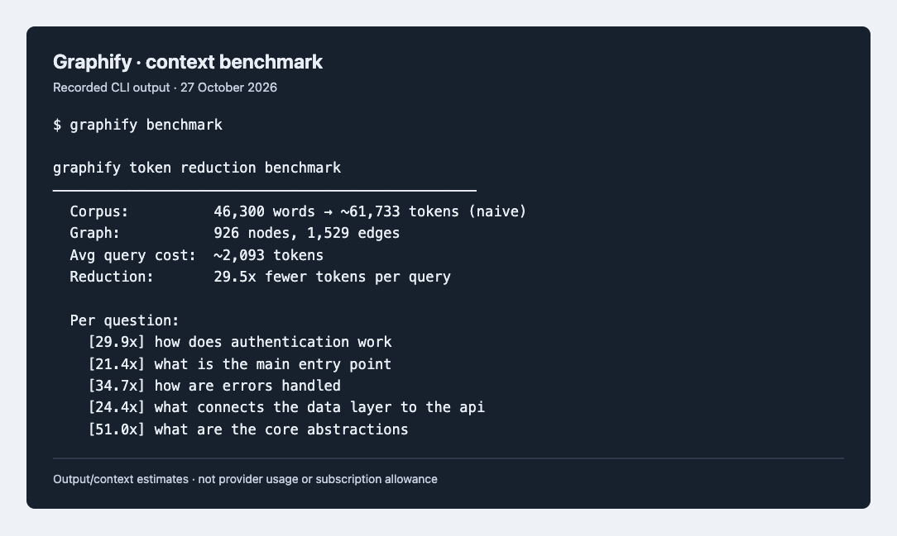
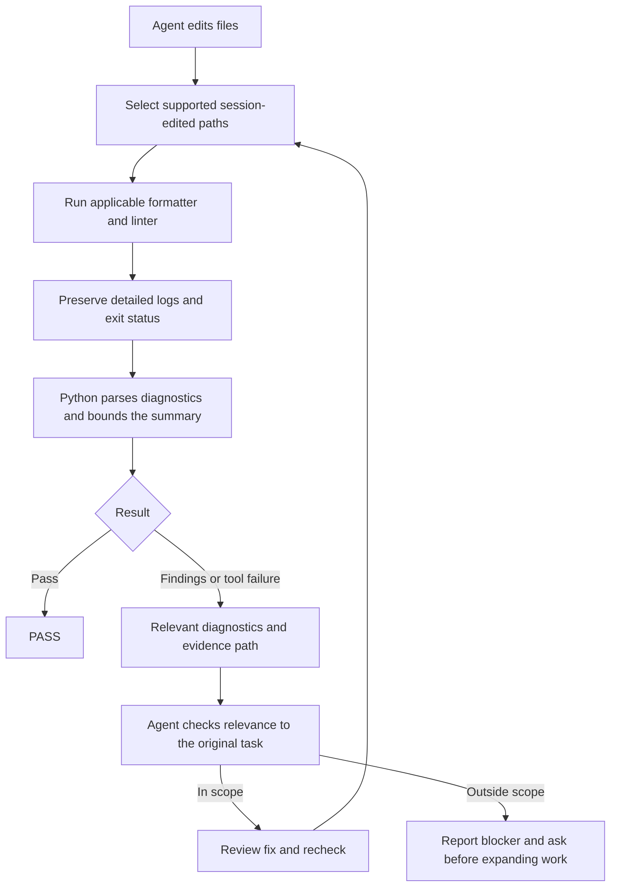

# VibeHelper

VibeHelper adds a small Codex or Claude Code workflow to an existing project.
It supports macOS and Ubuntu WSL.

The generated files tell the assistant what to read, how to check its edits,
and where to keep useful repo notes. Hooks can enforce shell policies, check
edited files, and trim noisy command output before it reaches the assistant.

## What it helps with

- The assistant starts with project instructions instead of guessing how the
  repo works.
- Hooks check edited files after changes and again before the assistant stops.
- Long lint and security output gets trimmed so the assistant can focus on the
  useful part.
- Stable project knowledge can live in `codebase-wiki/` instead of being
  rediscovered every session.
- Session notes can be kept in `notes/`, which makes it easier to trace what
  was asked and what changed.
- Writing help is included through Humanizer, so generated prose can sound less
  stiff.
- Existing helper-managed tools can be refreshed without replacing unrelated
  installations.

## What you gain

You spend less time repeating repo context, and future sessions have a place to
pick up durable knowledge. Each project can use only the workflow pieces that
fit.

This repository is intended for personal workflow bootstrapping across
multiple projects.

## Install it in another repo

Run the installer from the project you want to configure. If it is outside a
Git repository, the installer runs `git init`. Existing repositories and linked
worktrees are reused. Dry runs only report the initialization. No files are
staged or committed. Preview first.

For Codex:

```sh
bash /path/to/VibeHelper/CodexHelper/install.sh --dry-run
bash /path/to/VibeHelper/CodexHelper/install.sh
```

For Claude Code:

```sh
bash /path/to/VibeHelper/ClaudeHelper/install.sh --dry-run
bash /path/to/VibeHelper/ClaudeHelper/install.sh
```

If you run the command from somewhere else, pass the target repo:

```sh
bash /path/to/VibeHelper/CodexHelper/install.sh --repo /path/to/project
bash /path/to/VibeHelper/ClaudeHelper/install.sh --repo /path/to/project
```

Both installers also support `--repo-only` when you want project files without
global tool installs.

Use the default command for a first install. On a rerun, versioned managed
files stay in place unless you request an update.

For an existing installation, `--force` is the in-place update path. It
refreshes
managed files and installed helper-managed tools:

```sh
bash /path/to/VibeHelper/CodexHelper/install.sh --force
bash /path/to/VibeHelper/ClaudeHelper/install.sh --force
```

Refreshes use the detected package owner, such as Homebrew, apt, uv, pipx, npm,
or Composer. Unknown or unrelated installations are reported and left
unchanged. Managed files are backed up before replacement. If ClaudeHelper
finds an existing Codex setup, it refreshes its own scripts, hooks, instructions
and Makefile while preserving shared project files. Ordinary `--force`
updates skip Context7 setup. They also keep the existing code-review-graph MCP
configuration unless the code-review-graph package version changes.

Both installers configure Chrome DevTools MCP through
`npx chrome-devtools-mcp@latest`. A correct existing registration is left
unchanged on normal, force, and fresh runs because `@latest` resolves updates
when the server starts. `--force` repairs stale registrations; use
`--no-chrome-mcp` to skip setup. Chrome itself is not installed: use current
stable Chrome and a package-supported Node.js version (currently
`^20.19.0 || ^22.12.0 || >=23`). Inside WSL, install Linux Chrome or configure
an explicit connection to Chrome running outside WSL.

Both helpers have a non-interactive fresh setup that installs missing tools and
replaces existing helper-managed skill and tool files. Codex fresh installs
explicitly target Codex, including Humanizer, Unlazy, Graphify, Context7,
Chrome DevTools MCP, and Impeccable:

```sh
bash /path/to/VibeHelper/CodexHelper/install.sh --fresh-install --yes
bash /path/to/VibeHelper/ClaudeHelper/install.sh --fresh-install --yes
```

Fresh installs configure the code-review-graph MCP integration. The generated
Codex and Claude instructions require a separate reviewer agent after
substantive coding to check for breaking changes, scope creep, and drift from
the request.

When RTK is installed, the generated command-routing hook can trim eligible
read-only output before the assistant sees it. Shell expansions and potentially
mutating commands pass through unchanged. RTK records the raw and filtered
output sizes for routed commands and estimates tokens from those sizes. The
result is useful for comparing output reduction, but it is not a model-provider
usage or billing count.

CodexHelper records RTK's project-counter change during a Codex session and
code-review-graph's own context estimate. Run
`make -f vibe_scripts/codex/Makefile savings-ai` for the latest
report. The figures stay separate because they measure different baselines;
VibeHelper does not claim a combined total for features that cannot be measured.

## Local Codex usage dashboard

The usage tracker reads recorded Codex usage across local projects. Its live
dashboard lets you select a project, compare model totals, and open the largest
sessions to inspect their turns. Each browser tab retains its own project
selection. Refreshes reuse unchanged session data; switching projects filters
the cached snapshot.

From a project with CodexHelper installed, run:

```sh
python3 vibe_scripts/codex/usage-tracker.py setup
~/.local/bin/vibe-usage
```

Setup requires Python 3.11 or later and Git. It saves the Codex log location and
installs a shared launcher. On macOS, you can also open
`~/Applications/VibeHelper Usage.command`. The dashboard starts when opened;
keep its terminal open while using it. It does not start automatically at login.
ClaudeHelper includes the same tracker under `vibe_scripts/claude/`; it currently
tracks Codex usage only.

Collection and rendering run locally without model calls or usage uploads.
Setup downloads the pinned parser unless supplied with a local checkout.
Recorded tokens, cached input and reasoning are shown separately; cached input
and reasoning are subsets, not additional usage. These counts do not measure
weekly subscription allowance or exact per-file waste.

See the [usage tracker guide](templates/vibe_scripts/usage-tracker.md) for log
locations, date filters, offline reports and installation details.

## Stage completed changes

After code changes, agents write `git-add.txt` with the reviewed files for that
task. Review the diffs, then run from the project root:

```sh
git add --pathspec-from-file=git-add.txt
```

Directly below the staging command in their final reply, agents review every
file in `git-add.txt`: its exact path, what changed, and why the task needs it.
List one file per line with its own explanation; never group multiple file paths
on one line.
These are files selected for staging. Excluded files and reasons are reported
separately.

Agents inspect each diff and list only necessary source, tests, configuration,
docs and requested assets. They exclude secrets, local tooling, logs, caches,
backups, installed dependencies, build output and temporary reports. Package
manifests belong in the list for intentional package configuration changes;
lockfiles require an intentional dependency or toolchain change.
The list uses explicit literal file paths; it is never a dump of all Git status
output. Ignored files and the manifest itself are excluded.

Files containing unrelated edits are left out and reported for manual hunk review.
Every entry requires review of its full staged and unstaged diff, or its full
contents for a new file. Agents record why each file belongs and check for
secrets, private data and unintended changes. Required companion files must
also be reviewed or already committed; incomplete dependent changes stay out.
Uncertainty means exclusion, with the reason reported to you.

After formatting, agents check exact paths and preview the nonempty list with
`git add --dry-run --pathspec-from-file=git-add.txt`. The final reviewer checks
the list and evidence. Any later file edits require a fresh review. Existing
staged changes are reported separately; this list does not remove them.

Staging still includes every edit in each listed file. Running
`git add git-add.txt` only stages the manifest.
Agents leave staging and committing to you.
See the [staging handoff example](#reviewed-staging-handoff) for the manifest,
preview output and per-file explanation.

## Free model delegation with OmniRoute

Installers ask whether to install OmniRoute and its dashboard, with no as the
default. Only an explicit yes starts setup; empty input or EOF skips it.
`--yes` does not approve this optional installation. Both helpers share
`~/.local/share/vibehelper/omniroute/`. An existing
compatible global executable is reused; otherwise the installer installs the
verified version privately. Project scripts and instructions are installed for
Codex and Claude on both macOS and WSL. `--force` updates existing projects.

Setup asks you to choose a dashboard password. It preserves an existing
password. Unattended setup needs `VIBEHELPER_OMNIROUTE_PASSWORD` supplied by you;
without it, the runtime installs and configuration stays pending. It never
invents a dashboard password. The dashboard is at <http://127.0.0.1:20130>.
Use `--no-omniroute` to skip runtime setup, or `--repo-only` for project files.
Node.js must satisfy OmniRoute's requirement: `>=22.22.2 <23 || >=24 <27`.

Create an [OpenRouter account and API key](https://openrouter.ai/settings/keys),
then run the matching project helper and enter the key at its hidden prompt:

```sh
python3 vibe_scripts/codex/omniroute.py connect openrouter
# For Claude projects, use vibe_scripts/claude/omniroute.py instead.
```

For a suitable simple task, agents ask whether you want to try OmniRoute to
save tokens, unless you already authorized it. They wait for your reply before
sending task context. If you decline, the current agent continues. After approval,
they try one bounded request. The installer ships no fixed model list: the helper
discovers models for eligible accounts, checks context size, and ranks candidates
for `code`, `edit`, `summary` or `extract` using capability and name hints. Use
`ask --task edit` with the task on stdin; `route --task edit` previews selection
without inference. Ranking is heuristic and every proposal needs main-agent
review and the normal project checks. Token savings are not yet measured.

The generated `agent/codex/usage.md` (or Claude equivalent) describes a fixed
12-task comparison across Python, JavaScript and PHP. Startup instructions load
detailed quality and staging procedures when needed. Hook reports keep full
diagnostics on disk; compact messages do not skip checks or unblock failures.
`python3 vibe_scripts/codex/project-memory.py usage` reports local text sizes
separately from unknown token and weekly-allowance savings. After reviewing an
OmniRoute proposal, use `review --attempt-id ID --outcome accepted` (or `revised`
or `rejected`) to record its quality outcome without changing route ranking.

Add accounts through the dashboard. Use `report` to find connection IDs, then
`confirm-free CONNECTION_ID --billing-disabled` only after verifying free-only
API usage, disabled paid billing and no spendable paid credits. `all` confirms
current accounts only. Revoke with `revoke-free CONNECTION_ID` before changing
credentials or billing; confirmations do not track credential replacements.
OpenRouter uses independently verified zero-price models without confirmation.
Kilo Gateway also requires zero-price catalog entries. Other audited API-key
providers are Gemini, Groq, NVIDIA, Cloudflare AI and SambaNova.

Every `ask` checks cooldowns, model locks and recent OpenRouter free-request
estimates. Other quota observations are advisory because their scope varies.
Discovery uses account caches, fetching model metadata on cache misses. It sends
no inference probes. The single attempt uses a temporary key restricted to its
account and model, deleted afterward and backed by expiry. Managed setup disables
cloud sync. Unavailable routes or rejected output return work to the main agent.

Use `start` after reboot; no login service is installed. `status` checks gateway
policy; successful inference needs a real task. Project cleanup leaves the shared
runtime and accounts intact. Provider privacy terms apply to submitted snippets.

For a manual inventory, run `python3 vibe_scripts/codex/omniroute.py report`
(or the Claude path). Add `--json` for structured output, or `--refresh-models`
to fetch current model metadata for the seven audited API-key providers listed
in the installed OmniRoute guide. Default reporting reads local caches only.
The report includes connections, model IDs, recorded gateway tokens, quota
snapshot times and local rate-limit status. Unreported remaining tokens and
provider limits are unknown. OpenRouter free-request counters are local estimates;
model catalogs do not prove account access or free pricing.

## What gets added

The inventory below covers files created by the helpers and their integrations.
`<provider>` means `codex` or `claude`. Optional tools add their files only when
enabled; graphs, logs and reports are created when their commands or hooks run.

### Project files and settings

| Location | What gets added and why |
| --- | --- |
| `AGENTS.md` / `CLAUDE.md` | Provider instructions for scope, review, verification, logging and tool use. |
| `agent/<provider>/` | `index.md`, `commands.md`, `coding-rules.md`, `context-strategy.md`, `procedures.md`, `verify.md`, `omniroute.md`, `usage.md` and `evaluation.json`; Codex also receives `llm-council.md`. |
| `codebase-wiki/` | `index.md`, `architecture.md`, `testing.md`, `conventions.md`, `known-issues.md` and `risky-areas.md` for durable project knowledge. |
| `notes/` | `queries.md` and `conversation-log.md`; later, timestamped recommendations in `git-add-history/`. Prior log entries are preserved. |
| `git-add.txt` | The agent's reviewed staging recommendation, created after work; the history writer preserves previous recommendations. Nothing is staged automatically. |
| `.codex/` | Project `config.toml`, a reviewable `config-snippet.toml`, and policy, RTK, usage, post-edit and Stop hook scripts under `hooks/`. Controlled by the Codex hook options. |
| `.claude/` | Merged `settings.local.json`; policy, graph-first, RTK, post-edit and Stop scripts under `hooks/`; `commands/edited-ai.md`, `commands/verify-ai.md` and `commands/wiki-ai.md`. |
| Provider MCP configuration | Context7, Chrome DevTools and code-review-graph registrations when enabled. Codex uses its TOML configuration; Claude integrations use their selected user/project configuration, including project `.mcp.json`. |
| `.agents/skills/`, `.claude/skills/` and provider plugin directories | Skill files and plugin-managed hooks, according to the integration's provider and scope. See the installation table below. |
| `skills-lock.json` | Sources and update policies for Humanizer, Graphify, Impeccable and Ponytail. Unlazy and i-have-adhd have separate installer setup and are not entries in this lockfile. |
| `vibe_scripts/<provider>/Makefile` | Provider-specific controlled check, verification, wiki and skill targets; Codex also has `savings-ai`. Existing project Makefiles remain separate. |
| `.gitignore` | Managed exclusions for local agent files, graphs, notes, caches, backups and dependency directories. |
| `.graphifyignore`, `vibe_scripts/<provider>/memory-policy.json` | Graph-output exclusions and persistent choices for watching and enabled indexers. |
| `package.json`, npm lockfile, `node_modules/` | Codex's approved npm quality-tool installation adds development dependencies; it can create a minimal package manifest if none exists. |
| `composer.json`, `composer.lock`, `vendor/` | Codex's approved PHP quality-tool installation adds Composer development dependencies. |
| `biome.json` | Codex can create a missing configuration for detected static-web files; an existing Biome configuration is preserved. |
| `.impeccable/`, `PRODUCT.md`, `DESIGN.md` | Optional Impeccable setup/project initialization, alongside its skill and provider hook configuration. |

### Helper scripts and runtime artifacts

Both providers receive these files under `vibe_scripts/<provider>/`:

| Files | Purpose |
| --- | --- |
| `agent-verify.sh`, `agent-check-edited.py`, `ai-quality-wrapper.py`, `quality-hook.py`, `test-verification.py` | Controlled checks, edited-file selection, parsed diagnostics, hook results and test receipts. |
| `project-memory.py`, `project-memory-index.py`, `project-memory-watch.py`, `install-project-memory.py` | Source inventory, graph coverage, shared session watching and lifecycle-hook setup. |
| `update-codebase-wiki.py`, `sync-skills.py` | Maintain wiki drafts and check/update managed skills. |
| `write-git-add.py`, `cleanup-cache.py` | Keep staging-recommendation history and remove expired generated cache files. |
| `fallow.py` | Install and run the explicit JS/TS analysis command. |
| `omniroute.py` | Configure the optional gateway, route approved tasks and report history/usage. |
| `usage-tracker.py`, `usage-tracker.patch`, `usage-tracker.md` | Install and run the local Codex usage dashboard; delivered by either helper. |

Codex additionally receives `git-policy.py` for its global Git-policy adapter.
Session hooks record edited files and quality evidence, maintain memory watchers
and run cache cleanup. Codex also records RTK/context-reduction usage. A turn's
Stop event leaves the session watcher running; the last session exit releases it.

| Created during installation or later use | Contents |
| --- | --- |
| `.cache/vibehelper-install/` and `*.bak.*` | Ownership receipts, installation results and replacement backups; migrations include restoration instructions. |
| `.cache/ai-quality/`, `.cache/quality-tests/`, `.cache/quality-sessions/`, `.cache/hook-errors.log` | Full logs, parsed summaries, test receipts, session state and hook diagnostics. |
| `.cache/project-memory/`, `.code-review-graph/`, `.graphify/` or legacy `graphify-out/` | Inventory/coverage reports, watcher state/logs and generated graph databases/reports. |
| `.cache/vibehelper-tools/fallow/` | Pinned Fallow runtime when a project-local executable is unavailable. |
| `GATES.md`, `.unlazy/` | Acceptance ledgers and task evidence created when agents use Unlazy; these are not all pre-created by installation. |

### Shared user-level additions

| Location or setting | When it changes |
| --- | --- |
| Python tool environments and executable paths | Graphify, code-review-graph, Ruff and prerequisites use their supported package managers. Managed upgrades preserve detected ownership; shell PATH guidance/fixes may be offered. |
| `~/.codex/`, `~/.claude/`, `~/.agents/` | Enabled global skills/plugins and MCP registrations. Graphify registers provider skills from its executable; Codex also registers the agents skill location when supported. |
| `~/.codex/AGENTS.md` | Codex's enabled i-have-adhd setup adds its default response-style instructions. |
| `~/.codex/config.toml`, `~/.codex/hooks/ai_git_blocker.py` | Optional approved global Codex Git-policy installation; project hooks are separate. |
| `~/.local/share/vibehelper/omniroute/` | Optional shared gateway runtime, private settings/accounts and attempt history; no login service is installed. |
| `~/.local/share/llm-council/` | Optional LLM Council checkout; service dependencies and provider credentials still need separate setup. |
| `~/.local/share/vibehelper/token-usage/`, `~/.local/share/vibehelper/usage-dashboard/`, `~/.cache/vibehelper/usage/` | Explicit tracker `install`/`setup` downloads its pinned dependency and creates the shared launcher; copying project scripts alone does not start a dashboard. See [dashboard setup](#local-codex-usage-dashboard) for launcher locations. |

For an exact run's configured, skipped and failed components, use the installer
summary and its receipt. A listed capability is not proof that its package,
credentials or hook trust are ready on a particular machine.

## Project memory and planning

To preview cleanup of legacy automatic graph hooks and repeated quality checks:

```bash
python3 fix-hooks.py /path/to/project --include-global
```

The same command accepts a parent folder, such as `/Users/n/Code`, to find
installed repositories. Add `--clean-caches` to apply the same retention as the
background Stop hook: remove diagnostic logs and repair reports older than 72
hours, keeping the newest file in each group. Session locks, state, graph indexes
and recent evidence remain. Media backup retention keeps the newest completed
archive of each type under `.cache/between-backups`; database and curation
snapshots also keep anything from the past three days. Unknown files and distinct
media encodings remain. To delete a specific cache directory completely, name it
with `--remove-cache NAME`; this overrides retention for that path and can remove
recovery backups.

Every installed provider gets `vibe_scripts/<provider>/cleanup-cache.py` and one
Stop registration. The launcher detaches the worker and returns immediately; a
shared lock prevents overlapping cleanup. The worker writes its last result to
`.cache/cleanup-cache-last.json`. Backup completion checks use producer markers;
legacy media exports without a marker require a successful gzip integrity read
before older copies are removed. That read happens only while duplicates exist.

Add `--apply` to install the reviewed changes with backups. Omit `--include-global`
to leave user configuration alone. The cleanup preserves custom hooks and refuses
unrecognized quality helpers or Git blockers. Start a new agent session afterward.
Graph refresh remains available through the project-memory commands below.
Automatic hooks format and lint supported, existing edited files. Unsupported
files, such as swap files and media, are skipped. Detailed logs stay on disk;
failure summaries show relevant diagnostics and an evidence path. Successful
checks emit `PASS`. Moves are checked at the
new path; removed paths remain recorded in session history. Deletion-only changes
skip edited-file checks silently and record that no checks ran. Hooks
do not launch test suites, require test receipts, or scan installed dependencies.
Real edited-file findings and missing session baselines still block completion.
At Stop, changed UI markup or styles also require scoped design review. Logic-only
changes do not trigger it; see [design review](DESIGN-REVIEW.md).

After deleting, moving or refactoring files, run the project's tests explicitly:

```bash
make -f vibe_scripts/codex/Makefile test-ai
```

Use `vibe_scripts/claude/Makefile` for Claude, or `verify-ai` for the full controlled
verification. Test failures retain their nonzero exit status. Both providers' macOS
and WSL installers deliver this separation; existing installations receive it on
managed refresh. No session reset or cache deletion is required.

Both helpers install `project-memory.py` in their provider directory. Before
substantial planning, request a brief for the task and the files being inspected:

```bash
python3 vibe_scripts/codex/project-memory.py context \
  --task "Fix tracking attribution" --files src/tracking.py
```

Use `vibe_scripts/claude/` for Claude. Add `--architecture` when broader Graphify
context helps. The brief links relevant wiki pages, queries code relationships
and tests, and reports freshness. Confirm the source before relying on a graph
finding; inspection does not authorize unrelated edits or design work.

Agent sessions share one watcher per project. It refreshes both code indexes
three seconds after the last save, including untracked files and nested Git
repositories. Saves during indexing queue another refresh. The watcher stays
alive between replies and exits when the last session ends or its agent process
exits. Use `--no-memory-watch` during installation or set `watch` to `false` in
`vibe_scripts/<provider>/memory-policy.json` to disable it.

`status` reports watcher health, pending counts, coverage and diagnostic logs.
Complete inventories are saved under `.cache/project-memory/*-report.json`.
Coverage distinguishes indexed, unsupported, excluded and failed source files;
Git-ignored files and generated output are omitted from the working inventory.
Failed scans retain previous graphs. Markdown, PDFs and images await separate
semantic review; the watcher never launches AI interpretation.
Manual `context`, `status` and `refresh --architecture` remain available. Missing
tools and failed updates remain visible without blocking ordinary coding.
Custom graph watchers remain untouched. Neither command installs or upgrades tools.

To migrate an existing installation using this checkout:

```bash
python3 templates/vibe_scripts/managed-install.py memory-discover --provider codex
python3 templates/vibe_scripts/managed-install.py memory-refresh \
  --provider codex --root /path/to/project --dry-run
python3 templates/vibe_scripts/managed-install.py memory-refresh \
  --provider codex --root /path/to/project
```

Repeat for Claude with `--provider claude`. Migration touches memory helpers,
their hook registrations and the known memory-guidance paragraph. It preserves
custom policy keys and explicit watcher opt-outs. Modified helpers require
review; `--previous-source` accepts a directory containing an independently
verified previous release for exact byte comparison. Each migration writes a
backup manifest and `RESTORE.txt` under `.cache/vibehelper-install/memory-backup-*`.
It then refreshes both graphs and records coverage, duration and diagnostics in
that backup's `result.json` and `refresh.log`. Incomplete coverage returns nonzero.
Start a new agent session to load the installed session hooks.

Quality checks report a concise pass notice or parsed failure diagnostics with
log line locations. Complete logs and parsed JSON evidence stay on disk.
Unrecognized output and reports too large to display are flagged for review;
they never fall back to an arbitrary log tail. If the diagnosis needs context,
read just the relevant section with
`./vibe_scripts/codex/agent-verify.sh report /path/to/log --context-line 42`.
This returns five surrounding lines on each side. Agree on a narrower record
when that section is still too large; do not read the whole file by default.
Use the corresponding Claude helper in Claude projects.

Existing installations can receive only these reporting helpers with
`python3 templates/vibe_scripts/managed-install.py reporting-refresh --provider codex --root /path/to/project`.
The managed updater preserves customized files and writes restoration backups.

After reviewing staging recommendations, save their literal pathspecs with
`python3 vibe_scripts/codex/write-git-add.py < /path/to/reviewed-manifest.txt`.
This updates `git-add.txt` and writes a timestamped copy under
`notes/git-add-history/`. It also preserves the previous recommendation before
replacement. History stays local and outside staging; the command never stages
or commits files.

Generated reports, caches and session logs are excluded from Graphify inputs.
Use `wiki-ai` only for durable knowledge, review its generated diff, and preserve
handwritten sections. See `agent/codex/context-strategy.md` or its Claude
equivalent for recording a completed semantic review.

## What it can install

This is the direct installation inventory for the macOS and WSL helpers.
Package managers resolve each tool's transitive dependencies. “Default” means
the setup path is enabled, subject to prompts, prerequisites and explicit
opt-outs; it does not mean every integration is active without further setup.

### Skills, plugins and agent tools

| Component | Purpose | Codex setup | Claude Code setup |
| --- | --- | --- | --- |
| Humanizer (`blader/humanizer`) | Edit generated prose. | Default project skill setup; `--no-humanizer` skips. | Default skill setup; `--no-humanizer` skips. |
| Unlazy (`Leonxlnx/unlazy`) | Record acceptance gates and verify completion. | Default project skill setup. | Default skill setup. |
| Ponytail (`DietrichGebert/ponytail`) | Keep implementation and review small and complete. | Offers marketplace registration; finish plugin installation in `/plugins` and review `/hooks`. | Installs the plugin by default; `--no-ponytail` skips. Review hook trust. |
| i-have-adhd (`ayghri/i-have-adhd`) | Concise, action-first responses across sessions. | Default plugin and global response-style setup; `--no-adhd` skips. | Not installed by ClaudeHelper. |
| Impeccable | Frontend design skill, project design records and hooks. | `--impeccable` or `--fresh-install`; existing installations can be refreshed. | `--impeccable` or `--fresh-install`; existing installations can be refreshed. |
| Graphify (`graphifyy`, executable `graphify`) | Code/knowledge graphs and the Graphify skill. | Default package and provider skill registration. | Default; `--no-graphify` skips. |
| code-review-graph | Code relationship graph and MCP tools. | Default setup; initial build enabled unless `--no-crg-build`. | Default registration unless `--no-crg`; initial build requires `--crg-build`. |
| Context7 (`ctx7` setup) | Current library/API documentation through MCP. | `--context7`, fresh install, or interactive offer; existing registration is checked. | Default project MCP setup; `--no-context7` skips. |
| Chrome DevTools MCP (`chrome-devtools-mcp`) | Browser inspection and debugging. | Default registration; `--no-chrome-mcp` skips. | Default registration; `--no-chrome-mcp` skips; an enabled existing plugin can be reused. |
| RTK | Reduce command output before it reaches the agent. | Default with Codex hooks; `--no-rtk-hook` skips. | Default; `--no-rtk` skips. |
| OmniRoute | Local gateway for approved small tasks and usage/history reports. | Explicit setup consent; `--yes` does not approve it; `--no-omniroute` skips. | Same consent and skip behavior. |
| LLM Council (`karpathy/llm-council`) | Optional multi-model review application. | `--with-llm-council` clones the repository. | `--with-llm-council` clones the repository. |
| Codex usage tracker | Local dashboard using a pinned token-usage parser. | Scripts delivered; run tracker `install`/`setup` explicitly. | Same scripts delivered; they still read Codex logs. |

The skill/plugin rows describe VibeHelper's direct selections, including items
outside `skills-lock.json`. Upstream plugins may bundle several commands or
skills; their own installed manifests define that version's contents. Context7
and code-review-graph are MCP integrations, not additional VibeHelper skills.
The Ponytail bundle includes `ponytail`, `ponytail-review`, `ponytail-audit`,
`ponytail-debt`, `ponytail-gain` and `ponytail-help`: implementation discipline,
change review, repository audit, shortcut tracking, savings and usage guidance.

### Quality tools

Codex detects project languages, offers missing tools, and wires the checks.
`--install` accepts missing quality-tool installation; `--no-install` uses existing
tools. Claude wires existing quality tools and project scripts; it does not
install the Ruff, npm lint, PHP or shell packages listed below. Both providers
install Fallow for detected JS/TS projects when package installation is allowed.

| Tool/package | Purpose | Installation and location |
| --- | --- | --- |
| Ruff (`ruff`) | Python formatting and lint. | Codex installs with `uv tool`; upgrades recognize uv/pipx ownership. Claude uses an existing executable. |
| Biome (`@biomejs/biome`) | JS/TS, CSS and JSON checks/formatting. | Codex adds an npm development dependency for detected web/Node/TS projects. |
| HTMLHint (`htmlhint`) | HTML diagnostics. | Codex adds an npm development dependency for detected web/Node/TS projects. |
| markdownlint-cli2 | Markdown checks and supported fixes. | Codex adds an npm development dependency when Markdown is detected. |
| ShellCheck (`shellcheck`) | Shell diagnostics. | Codex uses Homebrew on macOS or apt-get on WSL when shell files are detected. |
| shfmt | Shell formatting. | Same language detection and package-manager route as ShellCheck. |
| PHP_CodeSniffer (`squizlabs/php_codesniffer`) | `phpcs` checks and the `phpcbf` fixer. | Codex adds a Composer development dependency for PHP projects. |
| PHPStan (`phpstan/phpstan`) | PHP static analysis. | Codex adds a Composer development dependency for PHP projects. |
| Fallow (`fallow`) | JS/TS dead-code, dependency and code-quality analysis. | Both reuse a local executable or install the pinned npm package in `.cache/vibehelper-tools/fallow/`; requires Node.js 22+. Runs only on explicit request. |

Detected tools are also usable without being installed by VibeHelper: Codex's
quality wiring recognizes **mypy or Pyright**, **pytest**, project npm
`lint`/`format`/`typecheck`/`test` scripts, **PHP's syntax checker**, **Go/gofmt/go
vet/go test**, **Staticcheck**, **Cargo/rustfmt/Clippy**, and **.NET**
format/build/test commands. Claude's generated Makefile adds existing npm
typecheck/test scripts alongside the shared edited-file checks. A command
adapter or recommendation does not mean its toolchain was installed.

### Prerequisites and installation modes

| Prerequisite | What the installers do |
| --- | --- |
| Git, Python 3, Node.js/npm/npx and the selected agent CLI | Use them to create files, run setup and register integrations. The Codex and Claude Code CLIs themselves are not installed. |
| Homebrew, uv and pipx on macOS | Codex offers prerequisite setup; `--install-prereqs`, `--install-brew`, `--install-uv` and `--install-pipx` explicitly select it. `--yes` alone does not install Homebrew. Claude installs uv through existing Homebrew or uv's official script if neither uv nor pipx is available. |
| Ubuntu WSL base packages | `curl`, `git`, `ca-certificates`, `python3`, `python3-pip`, `python3-venv`, `pipx`, `nodejs`, `npm`. Codex requires `--install-system-packages`/`--install-prereqs` or interactive confirmation; Claude installs missing packages by default, with `--no-system-packages` to skip. |
| Composer | Codex can install it through Homebrew/apt-get when PHP tools need it. PHP itself must be available. |
| Chrome | Must already be installed or reachable through a configured browser endpoint. MCP setup does not install Chrome. |

`--repo-only` skips global tools and quality-package installation while writing
project files and wiring available tools. Codex can still set up project-scoped
Humanizer, Unlazy and selected Impeccable skills in this mode.
`--refresh-managed` skips global-tool and quality-package installation/upgrades.
Codex's current implementation still calls its project skill setup in this mode,
so Humanizer, Unlazy and selected/existing Impeccable setup can invoke `npx` and
fetch or refresh skill packages. It is not a guarantee of an offline run.
Optional dashboards, LLM Council dependencies, provider credentials, Impeccable
initialization and Codex hook trust remain separate setup steps.

Inventory sources: the [Codex installer](CodexHelper/install.sh) and its
[macOS](CodexHelper/MacOS/) / [WSL](CodexHelper/WSL/) phases; the
[Claude installer](ClaudeHelper/install.sh) and its
[macOS](ClaudeHelper/MacOS/) / [WSL](ClaudeHelper/WSL/) phases;
[shared helpers](templates/vibe_scripts/) and the
[skills lockfile](templates/skills-lock.json).

## How the tools help

### Codex project files

New sessions need the project's conventions and commands. `AGENTS.md`, repo
notes, hooks and helper scripts give Codex that starting point and connect edits
to scoped quality checks.

**Example:** after editing a Python file, the hook formats and lints that file
and returns a short result.

### Claude Code project files

`CLAUDE.md`, hooks, slash commands and helper scripts bring the same workflow
into Claude Code's native configuration.

**Example:** a new Claude session reads the repo instructions and uses its
installed verification script to check edited files.

### Git command guards

An agent can accidentally stage unrelated edits, rewrite history or publish
unfinished work. Once activated, `PreToolUse` hooks inspect supported agent
shell calls and block selected Git commands before execution. Local Python
parses the command; this check makes no LLM call.

| Command | Hook behaviour |
| --- | --- |
| `git status`, `git diff`, `git log`, `git show` | Available for inspection. |
| Plain `git add --dry-run ...` | Allows a staging preview without staging. |
| `git add`, `git commit`, `git push` | Blocks agent staging, committing and publishing. |
| `git pull`, `git checkout`, `git switch`, `git reset`, `git clean`, `git merge`, `git rebase` | Blocks these working-tree, branch and history operations. |

Example reason returned by the Codex hook for `git add src/app.py`:

```text
git add is blocked for AI tools; stage files manually.
```

These are agent hooks; your own terminal commands remain available. Provider
blocklists differ, and hook activation is required. They also reject selected
destructive shell commands, such as `sudo rm` in Codex and recursive `rm` in
Claude. See [activation steps](#after-install).

### Reviewed staging handoff

The agent reviews the task's complete diffs and writes explicit paths to
`git-add.txt`. This avoids handing you a blanket `git add .` that could include
unrelated work. It previews the selection and explains each file; you run the
actual staging command.

Example `git-add.txt`:

```text
:(top,literal)src/app.py
:(top,literal)tests/test_app.py
```

Preview command and example output:

```console
$ git add --dry-run --pathspec-from-file=git-add.txt
add 'src/app.py'
add 'tests/test_app.py'
```

The handoff includes the command for you to run, followed by the file review:

```sh
git add --pathspec-from-file=git-add.txt
```

| Selected file | What changed and why |
| --- | --- |
| `src/app.py` | Fix the empty-input case requested in the task. |
| `tests/test_app.py` | Cover that case so it cannot silently regress. |

Excluded files are reported separately. Existing staged changes remain staged;
the manifest does not remove them. See the [full staging workflow](#stage-completed-changes).

### Humanizer

The agent uses editing rules to remove filler, inflated claims and repetitive
phrasing while preserving meaning. This is an LLM-assisted rewrite.

Example edit:

| Before: 27 words | After: 7 words |
| --- | --- |
| It is important to note that you will need to restart the application after making changes to the configuration in order for those changes to take effect. | Restart the application to apply configuration changes. |

### Context7

Remembered API details can be outdated. The agent identifies the library and
fetches documentation for the specific question through Context7's service.

**Example:** before changing authentication middleware, retrieve the relevant
framework's current middleware API and example.

### Chrome DevTools MCP

Browser tools let the agent inspect the DOM, console and network, operate
controls and capture screenshots. This exposes problems visible only when the
application runs.

**Example:** reproduce a failed form submission, inspect its network response
and confirm the repaired form works in the browser.

### Ponytail

Skill instructions keep small requests from growing into unnecessary
architecture. The agent favours existing code and the smallest complete change,
then checks its risks and verifies the result.

**Example:** reuse the project's date formatter for a new column instead of
adding another dependency and formatting layer.

### Unlazy

Long tasks can end with a convincing summary and unfinished work. Unlazy records
the required outcomes before implementation and checks the evidence before the
agent reports completion.

#### Acceptance gates

A gate is an observable condition that must hold for the task to be complete.
For example, a project-selector task might use these gates:

| Gate | Required evidence |
| --- | --- |
| Selecting a project shows only that project's usage. | A test with two projects passes. |
| Refresh preserves the selected project. | A refresh test passes. |
| The selector remains usable on a narrow screen. | A browser review records the viewport and result. |

Runnable gates store `CHECK` (the command), `EXPECT` (the success marker) and
`EVIDENCE` in `GATES.md`. Passing requires a zero exit status, the expected output
and evidence tied to the current check definition. Manual gates record review
evidence where a command cannot decide the outcome.

#### Other parts of the workflow

- **Task tree:** split larger work into bounded deliverables with dependencies,
  file ownership and their own gates. Small tasks use one ledger.
- **Review passes:** implement, review the approach, find defects and polish;
  repeat until the review is clean.
- **Independent verification:** in delegated work, the parent reruns checks and
  verifies that the pieces work together.
- **Honest handoff:** unmet or abandoned gates remain visible. The final report
  reconciles the original request with the evidence instead of declaring them done.
- **Optional stop check:** a separately enabled Claude Code hook checks gate and
  dispatch status. It does not execute tests; a progress guard releases repeated
  no-progress blocks after six attempts.

Gate commands require explicit approval before execution. Planning and review
use the agent; the gate checker itself runs locally without model calls.

### Graphify

Repeatedly reading a large repo uses context quickly. Graphify builds a
persistent graph of entities and relationships so focused queries can return
connected context with source references. Graph building or enrichment can use
models; its local benchmark does not.

**Example:** ask which modules handle authentication, then inspect those modules
and their connections. Graphify's context benchmark displays the comparison:



### code-review-graph

A small edit can break a distant caller. This code graph identifies callers,
dependents and affected flows so the agent can focus its source review and tests.

**Example:** before changing a shared validation function, find its callers and
check the affected API routes and tests.

### Impeccable

Design guidance helps the agent choose a clear hierarchy, readable typography
and consistent spacing. Browser inspection and design checks expose overflow,
weak focus states and awkward layouts. A deterministic detector supplements
the visual review.

**Example:** improve a dashboard's project selector, then inspect its keyboard
focus, spacing and narrow-screen layout. The Stop hook requires the detector
after design-related source changes, with existing enable/consent settings
preserved; logic-only edits do not trigger it.

### LLM Council

For decisions worth several model calls, [LLM Council](https://github.com/karpathy/llm-council)
collects answers through OpenRouter, has models review them and uses a chair
model to synthesize the result. VibeHelper can clone it; running it needs
separate setup and uses provider tokens.

**Example:** compare two migration strategies and review their tradeoffs before
committing to either implementation.

### OmniRoute

OmniRoute gives approved small tasks a route to eligible free models through a
local gateway. The helper checks account/model eligibility, makes one bounded
attempt and returns a proposal for the main agent to review. Attempt history
records outcomes and reported usage.

**Example:** delegate a small text extraction after approval, then have the main
agent check the returned fields. Tasks sent through the gateway reach the chosen
provider. See [OmniRoute setup](#free-model-delegation-with-omniroute).

### Codex usage tracker

The live local dashboard makes expensive sessions easier to find. It reads
recorded Codex logs and groups usage by project, model, session and turn.
Collection and rendering use local code, with no LLM calls or usage uploads.

**Example:** select a project, open its largest session and inspect the turns
with the highest recorded input. The counts show recorded tokens, not the
remaining weekly allowance. See [dashboard setup](#local-codex-usage-dashboard).

### RTK

Eligible read-only commands pass through filters that remove repetition and
routine noise before the agent reads the result. Filtering runs locally without
a model call.

Example `git status` output, shortened from **14 lines to 4**:

Before:

```text
On branch main
Your branch is up to date with 'origin/main'.

Changes not staged for commit:
  (use "git add <file>..." to update what will be committed)
  (use "git restore <file>..." to discard changes in working directory)
        modified:   src/app.py
        modified:   tests/test_app.py

Untracked files:
  (use "git add <file>..." to include in what will be committed)
        notes.txt

no changes added to commit (use "git add" and/or "git commit -a")
```

After, using `rtk git status`:

```text
main | 2M 1?
M src/app.py
M tests/test_app.py
? notes.txt
```

### Linters and formatters: the quality wrapper

**Problem:** raw linter logs can flood context, while repo-wide scans pull
unrelated work into the task. **Approach:** select supported session-edited files,
run the applicable checks, and parse their output before returning it to the
agent. Unsupported files, including swap files and media, are skipped.

Codex's command-policy hook also blocks direct linter and formatter commands
and points the agent to controlled verification routes. The agent must preserve
the selected file scope when retrying.

| Tool inside the wrapper | What it checks or fixes | Example |
| --- | --- | --- |
| **Ruff** | Formats and lints Python. | Normalize spacing; flag an unused import. |
| **Biome** | Formats and checks supported JavaScript, TypeScript, CSS and JSON. | Format a component; flag an unused variable. |
| **HTMLHint** | Reports HTML markup problems. | Flag duplicate element IDs. |
| **markdownlint-cli2** | Checks Markdown structure and style, with line-length checks disabled. | Flag a skipped heading level. |
| **ShellCheck + shfmt** | Check shell scripts and normalize formatting. | Flag an unquoted variable; fix indentation. |
| **PHP_CodeSniffer + PHPStan** | Check PHP style and static types; the companion fixer formats when configured. | Fix spacing; flag an incompatible argument type. |



The parser is **Python, not an LLM**. PHPCS, PHPStan, Pyright and ShellCheck have
structured JSON adapters; other outputs use text extraction. The wrapper retains
locations, rule IDs, relevant warnings and tool failures, not just lines
containing “error”. A parse failure is reported rather than treated as a pass.
Full evidence stays on disk; the hook's failure excerpt is capped at **12 lines
and 2 KiB**.

Illustrative agent-facing result:

```text
lint-shellcheck: findings
scripts/build.sh:8:6: warning [SC2086] Double quote to prevent globbing and word splitting.
Full log: .cache/ai-quality/<run>.log
```

Formatting and configured automatic fixes handle mechanical changes. The agent
reviews that diff and repairs remaining in-scope findings manually, then rechecks.
Tests, broader analysis and whole-project lint are separate explicit checks.
An unresolved finding stays blocked; an unchanged blocked Stop reuses its evidence
instead of rerunning the same checks.
Hook-input errors retain their exception details and locations in
`.cache/hook-errors.log`; the separate summary omits raw input and error text.

The wrapper limits what it checks and returns. The agent's scope instructions
require approval for unrelated work; a linter finding does not authorize it.
This reduces scope drift without claiming the parser can enforce every agent
decision.

## After install

Restart Codex or Claude Code in the configured repo so it reloads the new files.

For Codex, open `/hooks`, review and trust the project hooks, then start a new
thread. Hook trust cannot be automated. For Claude Code, restart in the repo
root so it reloads `CLAUDE.md` and `.claude/settings.local.json`.

Run one check after setup:

```sh
# Codex
./vibe_scripts/codex/agent-verify.sh edited
# Claude
./vibe_scripts/claude/agent-verify.sh edited
```

Trusted hooks handle normal edited-file checks after that. Pass `lint` to the
provider verifier to check edits without formatting, or `lint --all` to explicitly
lint the whole project. Use `verify` for large, risky,
security-sensitive or cross-project changes. Each verifier selects its own
Makefile. The project root Makefile is preserved.

Existing installs can use `--refresh-managed` to refresh managed instructions
and hooks while skipping global-tool and quality-package updates. Codex's
[project skill setup exception](#prerequisites-and-installation-modes) still
applies. `--force` also updates installed packages.
Legacy shared scripts and root targets remain available for manual review; new
commands use provider-specific paths. Cleanup preserves shared project data
and the other provider. See each helper README for the retained files.

## More detail

- [CodexHelper README](CodexHelper/README.md)
- [ClaudeHelper README](ClaudeHelper/README.md)

## Installation and check outcomes

See [the maintained flow and evidence](INSTALLATION-FLOW.md) for installer phases,
component states, migration, repair hooks, and verification limits.

Use `--refresh-managed` to refresh helper files, subject to the
[Codex project skill setup exception](#prerequisites-and-installation-modes).
`--force` still refreshes installed tools through their detected package manager.
Semgrep integration has been retired; `--security-scan` is unsupported. Existing
global binaries are left installed. Custom security checks remain project-owned.
